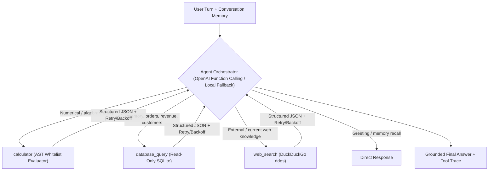

# SmartAgent — Multi-Tool LLM Assistant with Function Calling

SmartAgent is a multi-tool conversational AI assistant built around the **OpenAI function/tool-calling API** (with an automatic deterministic local routing fallback when no `OPENAI_API_KEY` is configured). It dynamically routes requests across a safe AST math evaluator, live DuckDuckGo web search, and a read-only SQLite analytics database while preserving conversational memory and retrying transient failures.

## Architecture



## Prompt & Tool Schema Design Decisions

1. **Disjoint Tool Responsibilities (`src/smartagent/schemas.py`):**
   - `calculator` explicitly owns all arithmetic, percentages, powers, and algebraic expressions (safe Python `ast` whitelist; arbitrary code constructs like `__import__` are rejected).
   - `database_query` explicitly declares the exact SQLite schema (`products`, `customers`, `orders`) in its function description and blocks any non-`SELECT`/`WITH` or multi-statement SQL at execution time (`?mode=ro` URI connection).
   - `web_search` is scoped strictly to external facts, public documentation, and current events so internal company analytics queries do not leak to external search.
2. **Error Recovery & Exponential Backoff (`src/smartagent/agent.py`):**
   - Transient API or search exceptions automatically retry with exponential backoff (`max_retries=3`).
   - Invalid tool arguments or SQL syntax errors return structured `{"ok": false, "error": ...}` payloads back into the OpenAI tool-call loop so the model can self-correct on the next round.
3. **Sliding Conversational Memory:**
   - Maintains ordered `user`, `assistant`, and `tool` turn records up to `max_history_messages=20` for multi-turn follow-ups (for example, `"Double that"` or `"What did I ask earlier?"`).

## Evaluation Results (50-Query Benchmark)

Measured via `uv run python eval/evaluate_routing.py` across **50 labeled queries** (15 calculator, 15 database, 12 web search, 8 direct/memory queries) in `local` mode, plus 10 simulated transient failure recoveries and a 3-turn memory test ([eval/results.md](eval/results.md)):

| Metric | Measured Result |
| :--- | :---: |
| **Overall Tool-Routing Accuracy (50 queries)** | **100.0% (50/50)** |
| Calculator Routing Accuracy | 100.0% (15/15) |
| Database Query Routing Accuracy | 100.0% (15/15) |
| Web Search Routing Accuracy | 100.0% (12/12) |
| Direct / Memory Routing Accuracy | 100.0% (8/8) |
| Transient Error Retry Recovery Rate | **100.0% (10/10)** |
| Multi-Turn Memory Completion | **PASS** |

*(When `OPENAI_API_KEY` is configured in `.env`, running `uv run python eval/evaluate_routing.py` evaluates live OpenAI `tool_choice="auto"` routing against the same 50-query suite.)*

## Sample Multi-Turn Transcript

```text
You> Show total revenue by region
Tool `database_query` -> North America: $5,795.00 | Europe: $3,362.00 | APAC: $387.00
SmartAgent> Database query returned 3 row(s):
{'region': 'North America', 'total_revenue': 5795.0}
{'region': 'Europe', 'total_revenue': 3362.0}
{'region': 'APAC', 'total_revenue': 387.0}

You> Calculate (1996 + 1494) * 1.08
Tool `calculator` -> ok=True
SmartAgent> `(1996 + 1494) * 1.08` = **3769.2**

You> Double that
Tool `calculator` -> expression='3769.2 * 2'
SmartAgent> `3769.2 * 2` = **7538.4**

You> What did I ask earlier?
SmartAgent> Earlier in this conversation you asked: 'Double that'.

You> What is Python FastAPI?
Tool `web_search` -> Top DuckDuckGo hits (Wikipedia, fastapi.tiangolo.com, ...)
```

## Quickstart

```bash
# 1. Install dependencies (Python 3.12 via uv)
uv sync --all-groups

# 2. Optional: configure OpenAI credentials (defaults to local router fallback if omitted)
cp .env.example .env
# Edit .env and set OPENAI_API_KEY=sk-...

# 3. Run unit & mocked OpenAI tool-calling tests
uv run pytest -v

# 4. Run the 50-query routing & retry benchmark
uv run python eval/evaluate_routing.py

# 5. Launch CLI or Streamlit UI
uv run python -m smartagent.cli
uv run streamlit run src/smartagent/app.py
```

## Project Structure

```text
smartagent/
├── eval/
│   ├── evaluate_routing.py        # 50-query routing + retry + memory eval
│   ├── queries_50.json
│   ├── results.json
│   └── results.md
├── src/smartagent/
│   ├── agent.py                   # OpenAI function-calling loop, retries & memory
│   ├── app.py                     # Streamlit chat & eval dashboard
│   ├── cli.py                     # Interactive Rich CLI
│   ├── config.py                  # Env & mode resolution
│   ├── schemas.py                 # System prompt & OpenAI JSON tool schemas
│   └── tools/
│       ├── calculator.py          # Safe AST math evaluator
│       ├── sql_db.py              # Seeded read-only SQLite analytics DB
│       └── web_search.py          # DuckDuckGo web search
└── tests/
    └── test_agent.py
```
